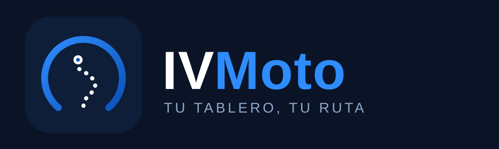

<p align="center"></p>

# IVMoto

Mapa, navegación y los botones del manubrio en el tablero de tu moto **CFMoto** con MotoPlay, por Wi‑Fi, desde tu teléfono Android: con **Android Auto** o con el tablero propio de IVMoto. Sin cuentas, sin anuncios y sin telemetría.

IVMoto es un **rediseño de [OpenCfMoto](https://github.com/zanderp/open-cfmoto)**, hecho para ofrecer una mejor experiencia. Ese proyecto fue el impulso: mira los [créditos](#créditos).

> IVMoto es un proyecto independiente y **no está afiliado a CFMoto**. "CFMoto" es marca de sus dueños y se menciona solo para indicar compatibilidad.

## Qué hace
- **Conexión:** Android Auto inalámbrico o tablero propio, con control táctil y botones del manubrio (Bluetooth), por el Wi‑Fi de la moto o Wi‑Fi Direct.
- **Mi moto:** catálogo CFMoto por serie, apodo y tu foto.
- **Mapa y rutas:** búsqueda de lugares, rutas rápida, divertida y circuito, evitar peajes, autopistas y terracería, giro a giro en el tablero, mapas sin conexión, lugares guardados y estacionamiento con nota y foto.
- **Seguridad en ruta:** recordatorio de descanso, aviso del límite de la vía, aviso de curvas cerradas, clima de la ruta y gasolineras cercanas.
- **Viajes:** grabación con GPS, gráfica de velocidad e imagen para compartir.
- **Tu moto:** mantenimiento por kilómetros con avisos, combustible con autonomía, y gastos con costo por km.
- **Tema** claro, oscuro o automático. Actualizaciones verificadas (hash y firma) que tú confirmas.

## Requisitos
Android 10 o superior y una moto CFMoto con MotoPlay. Para el modo Android Auto, la app Android Auto instalada.

## Seguridad y privacidad
- No envía datos de uso ni reportes de fallos a nadie. Ver [PRIVACY.md](PRIVACY.md).
- Respaldo en la nube de Android desactivado (tus viajes no salen del teléfono).
- Cómo reportar una vulnerabilidad: [SECURITY.md](SECURITY.md).
- Los APK oficiales se publican con su hash SHA‑256 y se firman con la llave de IVMoto.

## Servicios en línea y bibliotecas
La app consulta, solo cuando tú la usas: OpenStreetMap, OpenFreeMap, Nominatim y Photon (búsqueda), OSRM y Valhalla (rutas), Overpass (gasolineras y límites), Open-Meteo (clima) y GitHub (actualizaciones). Usa AndroidX y Material Components, MapLibre Native, osmdroid, ZXing, OkHttp, jmDNS, Conscrypt y Protocol Buffers. Detalle y licencias en [NOTICE](NOTICE).

## Compilar
Requiere Android Studio (o JDK 17+) y el SDK de Android.

```bash
./gradlew assembleRelease
```

Para firmar el APK de release define tu propia llave (ver SECURITY.md); **nunca** subas llaves al repositorio.

## Licencia
GNU AGPL v3 o posterior, la misma licencia del proyecto original. Los avisos de licencia y de los componentes de código abierto incluidos están en [NOTICE](NOTICE) y [LICENSE](LICENSE).

## Créditos
- **[OpenCfMoto](https://github.com/zanderp/open-cfmoto)**, de Alexandru y sus colaboradores: el proyecto original que dio el impulso a IVMoto. Gracias.
- **headunit-revived** (andreknieriem y colaboradores): de donde viene el receptor de Android Auto.
- Las ramas de open-cfmoto de coletz/dcoletto, richardbizik, BojanJ e ionutradu252, en las que se apoya OpenCfMoto.

Rediseñado por [IVSoftware](https://ivsoftware.pages.dev/) para una mejor experiencia.
